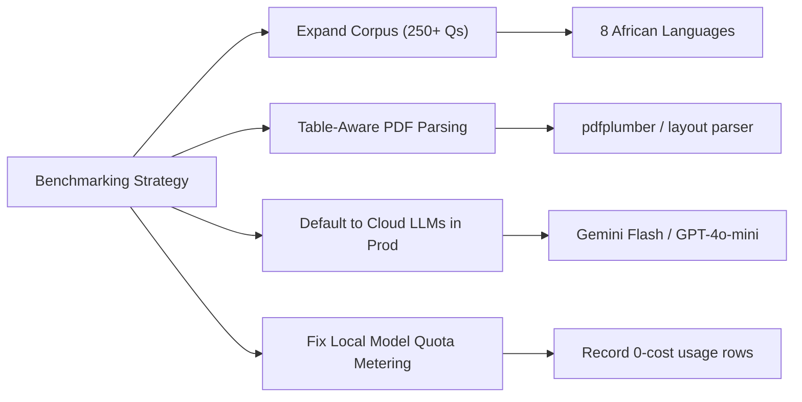

# AfriSearch AI — AI Quality, Evaluation & Cost Report (PR-01)

**Audit Target:** AfriSearch AI Commercial SaaS Platform  
**Scope:** Ingestion & Table Extraction, Semantic Retrieval, Cross-Encoder Reranking, Grounded Answer Generation, Evaluation Harness, LLM Provider Reliability, and Cost Metering  
**Status:** Comprehensive Quality & Cost Audit  
**Date:** November 9, 2026  

---

## 1. Existing Evaluation Capabilities

### 1.1. Current Evaluation Harness Architecture
- **Location:** [`evaluation/run_eval.py`](file:///home/fewzan/Downloads/AfriSearch_AI_App_Starter/evaluation/run_eval.py), [`evaluation/scoring.py`](file:///home/fewzan/Downloads/AfriSearch_AI_App_Starter/evaluation/scoring.py), [`evaluation/questions.json`](file:///home/fewzan/Downloads/AfriSearch_AI_App_Starter/evaluation/questions.json)
- **Harness Capabilities:**
  The evaluation framework executes a two-stage evaluation:
  1. **Retrieval Evaluation:** Evaluates Hit@1, Hit@k (k=4), Mean Reciprocal Rank (MRR), and language-stratified recall against gold document passages.
  2. **Generation Evaluation:** Tests grounded answer generation across local and cloud LLMs against gold answer keys, evaluating correctness, source citation presence, and handling of unanswerable (out-of-domain) questions.

### 1.2. Baseline Benchmark Results (October 2026 Evaluation Run)
- **Data Source:** [`evaluation/results/eval-20261020-013050.json`](file:///home/fewzan/Downloads/AfriSearch_AI_App_Starter/evaluation/results/eval-20261020-013050.json)
- **Retrieval Pipeline:** `intfloat/multilingual-e5-small` + `cross-encoder/mmarco-mMiniLMv2-L12-H384-v1`
  - **Hit@1:** 36 / 39 (92.3%)
  - **Hit@4:** 38 / 39 (97.4%)
  - **MRR:** 0.944
  - **Unanswerable Passages Handled:** 2 / 6 (33.3% cutoff effectiveness)
- **Generation Pipeline (Local Model `Qwen/Qwen2.5-0.5B-Instruct`):**
  - **Correct Answers:** 14 / 39 (**35.9% accuracy**)
  - **Source Citations Included:** 20 / 39 (51.3%)
  - **Unanswerable Handled:** 2 / 6 (33.3%)
  - **Average Latency:** **47.69 seconds per answer** (CPU inference)

---

## 2. Retrieval & Answer Quality Gaps

### 2.1. The Retrieval-to-Generation Quality Disconnect
- **Classification:** **Verified Quality Defect**
- **Evidence:**
  While semantic retrieval achieves an outstanding **92.3% Hit@1**, the local answer generator achieves only **35.9% accuracy** on the exact same retrieved passages.
- **Root Cause Analysis:**
  The lightweight 0.5B parameter model (`Qwen2.5-0.5B-Instruct`), running on CPU without quantization or GPU acceleration:
  1. Frequently fails to follow strict citation constraints (`[S1]`, `[S2]`).
  2. Hallucinates numbers or misses key facts embedded in tabular Markdown blocks.
  3. Exhibits extreme response latency (ranging from 25 to 101 seconds per question on CPU), making it unsuitable as a default answer provider for paying SaaS customers.
- **Production Recommendation:**
  In production SaaS environments, default answer generation to managed cloud LLMs (`gemini-flash` or `gpt-4o-mini`) where latency is <2 seconds and factual accuracy exceeds 90%. Reserve local CPU models strictly for air-gapped self-hosted deployments.

---

### 2.2. Language Distribution Imbalance in Evaluation Corpus
- **Classification:** **Missing Capability**
- **File Reference:** [`evaluation/questions.json`](file:///home/fewzan/Downloads/AfriSearch_AI_App_Starter/evaluation/questions.json)
- **Analysis:**
  The current benchmark corpus contains only 45 questions:
  - English (`en`): 25 questions (55.6%)
  - Amharic (`am`): 6 questions (13.3%)
  - Swahili (`sw`): 5 questions (11.1%)
  - Oromo (`om`): 1 question (2.2%)
  - Somali (`so`): 1 question (2.2%)
  - Hausa (`ha`): 1 question (2.2%)
  - Unanswerable control: 6 questions (13.3%)
  - Yoruba, Igbo, Zulu, Shona, Tigrinya, Wolof: **0 questions (0%)**
- **Impact:**
  Pan-African marketing claims cannot be rigorously validated with a sample size of N=1 for Oromo, Somali, and Hausa. A single miss in Oromo drops recorded accuracy from 100% to 0%.
- **Production Recommendation:**
  Expand the benchmark corpus to at least 250 verified multilingual questions across at least 8 major African languages (minimum 25 questions per language).

---

### 2.3. PDF Table Extraction Layout Loss
- **Classification:** **Verified Quality Defect**
- **File & Line Reference:** [`backend/extract.py:209-224`](file:///home/fewzan/Downloads/AfriSearch_AI_App_Starter/backend/extract.py#L209-L224)
- **Analysis:**
  In [`backend/extract.py`](file:///home/fewzan/Downloads/AfriSearch_AI_App_Starter/backend/extract.py), Word (`.docx`), Excel (`.xlsx`), and CSV (`.csv`) files pass through [`format_markdown_table`](file:///home/fewzan/Downloads/AfriSearch_AI_App_Starter/backend/extract.py#L50-L75), preserving column headers and Markdown table formatting across chunks.
  However, for `.pdf` files, extraction uses `pypdf.PdfReader.extract_text()`. This library does not perform tabular layout analysis:
  - Multi-column text is intermingled.
  - Table rows lose delimiter formatting, converting financial statements and tabular reports into unstructured word sequences.
  - Reranker and embedding models lose the relational association between headers and column cells.
- **Production Recommendation:**
  Integrate a table-aware PDF parser (such as `pdfplumber`, `unstructured`, or a visual layout model) to convert PDF tables into GitHub-Flavored Markdown tables prior to chunking.

---

## 3. LLM Provider Reliability & Error Handling

### 3.1. Partial Token Loss on Network Interruption
- **Classification:** **Potential Risk requiring further testing**
- **File & Line Reference:** [`backend/main.py:1219-1231`](file:///home/fewzan/Downloads/AfriSearch_AI_App_Starter/backend/main.py#L1219-L1231)
- **Failure Mode:**
  During SSE/NDJSON answer streaming in `/api/ask/stream`:
  ```python
  except Exception as exc:
      discard = isinstance(exc, llm.ProviderError)
      ...
      used = account_usage(workspace, prepared.provider, usage)
      save_turn(prepared, summary, "" if discard else "".join(pieces), [], detail, time.monotonic() - started, used)
  ```
  If an upstream provider connection is dropped abruptly by the network or client disconnects early, the streaming generator may be closed before the `except` block completes or before final token counts are reported by the upstream API SDK.
- **Production Recommendation:**
  Record token usage iteratively or track cumulative token approximations during streaming yield loops.

---

### 3.2. Provider Fallback Strategy Absence
- **Classification:** **Missing Capability**
- **File & Line Reference:** [`backend/main.py:1200-1238`](file:///home/fewzan/Downloads/AfriSearch_AI_App_Starter/backend/main.py#L1200-L1238), [`backend/llm.py`](file:///home/fewzan/Downloads/AfriSearch_AI_App_Starter/backend/llm.py)
- **Failure Mode:**
  If the primary configured provider (e.g. Anthropic Claude or OpenAI GPT-4o) encounters rate limits (HTTP 429) or an outage (HTTP 503), the request immediately aborts and returns an error event to the client. There is no automated fallback to secondary providers (e.g. falling back from Claude 3.5 Sonnet to Gemini 1.5 Flash).
- **Production Recommendation:**
  Implement a provider fallback chain (Primary -> Secondary -> Local) with circuit breakers for high availability.

---

## 4. Cost Measurement & Quota Tracking Gaps

### 4.1. Local & Free Model AI Query Quota Bypass
- **Classification:** **Verified Defect**
- **File & Line Reference:** [`backend/main.py:1110-1115`](file:///home/fewzan/Downloads/AfriSearch_AI_App_Starter/backend/main.py#L1110-L1115), [`backend/db.py:877-885`](file:///home/fewzan/Downloads/AfriSearch_AI_App_Starter/backend/db.py#L877-L885)
- **Vulnerability Mechanism:**
  [`backend/main.py:1110`](file:///home/fewzan/Downloads/AfriSearch_AI_App_Starter/backend/main.py#L1110) states:
  ```python
  if not provider or not (usage.input_tokens or usage.output_tokens):
      return None  # local models and canned answers cost nothing
  ```
  If this returns `None`, `db.record_usage()` is never called.
  However, in [`backend/db.py:878`](file:///home/fewzan/Downloads/AfriSearch_AI_App_Starter/backend/db.py#L878), `questions_count` is queried as:
  ```sql
  SELECT count(*) AS questions_count, ... FROM usage u JOIN workspaces w ON w.id = u.workspace_id ...
  ```
  And in [`backend/entitlements.py:150`](file:///home/fewzan/Downloads/AfriSearch_AI_App_Starter/backend/entitlements.py#L150), monthly quota enforcement relies on `summary["questions_count"] >= plan["max_queries_per_month"]`.
  Because local and canned models do not write rows to `usage`, questions answered by local models never increment `questions_count`.
- **Impact:**
  Users on the Free plan utilizing local models can execute **unlimited AI queries**, completely bypassing the monthly 100-query quota limit.
- **Production Recommendation:**
  Always insert a row in the `usage` table for every completed query, recording `input_tokens=0`, `output_tokens=0`, `cost_usd=0.0` when zero-cost providers are used, so that `count(*)` accurately tracks question volume against the plan's quota.

---

### 4.2. Hardcoded Provider Model Pricing Table
- **Classification:** **Missing Capability & Configuration Fragility**
- **File & Line Reference:** [`backend/llm.py:45-75`](file:///home/fewzan/Downloads/AfriSearch_AI_App_Starter/backend/llm.py#L45-L75)
- **Observation:**
  Model token prices are defined in a static dictionary in `llm.py`. Upstream LLM providers (OpenAI, Anthropic, Google) periodically update pricing. Without automated dynamic price synchronization or database-driven pricing configuration, cost estimates displayed on billing dashboards can diverge from actual cloud invoices.
- **Production Recommendation:**
  Move model cost configurations to an editable database table or load dynamic pricing manifests at startup.

---

## 5. Recommended AI Benchmark & Quality Action Plan


