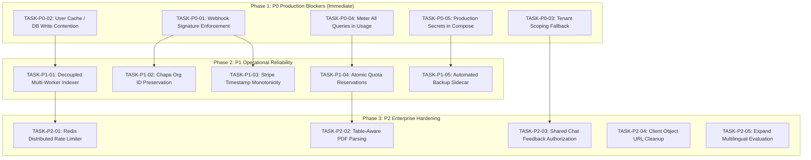

# AfriSearch AI — Production Remediation Action Plan (PR-01)

**Document Type:** Prioritized Implementation Roadmap  
**Target Platform:** AfriSearch AI Commercial SaaS  
**Audit Reference:** Production Readiness Audit PR-01  
**Status:** Ready for Review & Execution  
**Date:** November 9, 2026  

---

## 1. Executive Implementation Overview

This Action Plan provides a structured, phased roadmap to resolve all verified vulnerabilities, defects, architectural bottlenecks, and reliability gaps identified during the PR-01 Production Readiness Audit.

Tasks are prioritized into three strict tiers:
- **P0 (Production Blockers):** Must be resolved and verified before accepting any production traffic or live payment transactions.
- **P1 (High Priority):** Core operational stability, fair queuing, and billing consistency tasks required for GA release.
- **P2 (Medium Priority):** Enterprise enhancements, memory hygiene, benchmark expansion, and monitoring polish.

---

## 2. Prioritized Task Matrix

| Task ID | Tier | Title | Category | Est. Effort | Dependencies | Target Location |
| :--- | :---: | :--- | :--- | :---: | :---: | :--- |
| **TASK-P0-01** | **P0** | Stripe & Chapa Webhook Signature Secret Enforcement | Security | 2 hours | None | [`backend/billing/`](file:///home/fewzan/Downloads/AfriSearch_AI_App_Starter/backend/billing/) |
| **TASK-P0-02** | **P0** | Eliminate SQLite Write Contention in `ensure_user` | Reliability | 3 hours | None | [`backend/auth.py`](file:///home/fewzan/Downloads/AfriSearch_AI_App_Starter/backend/auth.py), [`backend/db.py`](file:///home/fewzan/Downloads/AfriSearch_AI_App_Starter/backend/db.py) |
| **TASK-P0-03** | **P0** | Enforce Tenant Scoping on Workspace Header Fallback | Security | 2 hours | None | [`backend/main.py`](file:///home/fewzan/Downloads/AfriSearch_AI_App_Starter/backend/main.py), [`backend/db.py`](file:///home/fewzan/Downloads/AfriSearch_AI_App_Starter/backend/db.py) |
| **TASK-P0-04** | **P0** | Meter All Queries in Usage Table (Fix Quota Bypass) | Billing | 2 hours | None | [`backend/main.py`](file:///home/fewzan/Downloads/AfriSearch_AI_App_Starter/backend/main.py), [`backend/db.py`](file:///home/fewzan/Downloads/AfriSearch_AI_App_Starter/backend/db.py) |
| **TASK-P0-05** | **P0** | Production Deployment Secret Forwarding & Docs | DevOps | 1 hour | None | [`deploy/`](file:///home/fewzan/Downloads/AfriSearch_AI_App_Starter/deploy/), [`.env.example`](file:///home/fewzan/Downloads/AfriSearch_AI_App_Starter/.env.example) |
| **TASK-P1-01** | **P1** | Decouple Indexer from Web Process (Multi-Worker Queue) | Performance | 1-2 days | P0-02 | [`backend/jobs.py`](file:///home/fewzan/Downloads/AfriSearch_AI_App_Starter/backend/jobs.py) |
| **TASK-P1-02** | **P1** | Chapa Webhook Full Org Identifier Preservation | Billing | 3 hours | P0-01 | [`backend/billing/chapa_provider.py`](file:///home/fewzan/Downloads/AfriSearch_AI_App_Starter/backend/billing/chapa_provider.py) |
| **TASK-P1-03** | **P1** | Monotonic Stripe Webhook Sequence Timestamp Checks | Billing | 4 hours | P0-01 | [`backend/billing/stripe_provider.py`](file:///home/fewzan/Downloads/AfriSearch_AI_App_Starter/backend/billing/stripe_provider.py) |
| **TASK-P1-04** | **P1** | Atomic Multi-Tenant Quota Check & Reservation | Quotas | 1 day | P0-04 | [`backend/entitlements.py`](file:///home/fewzan/Downloads/AfriSearch_AI_App_Starter/backend/entitlements.py) |
| **TASK-P1-05** | **P1** | Automated Disaster Recovery Backup Daemon Sidecar | DevOps | 4 hours | None | [`deploy/`](file:///home/fewzan/Downloads/AfriSearch_AI_App_Starter/deploy/), [`backend/backup.py`](file:///home/fewzan/Downloads/AfriSearch_AI_App_Starter/backend/backup.py) |
| **TASK-P2-01** | **P2** | Redis-Backed Sliding Window Rate Limiter | Reliability | 1 day | None | [`backend/limits.py`](file:///home/fewzan/Downloads/AfriSearch_AI_App_Starter/backend/limits.py) |
| **TASK-P2-02** | **P2** | Table-Aware PDF Parsing Integration | AI Quality | 2 days | None | [`backend/extract.py`](file:///home/fewzan/Downloads/AfriSearch_AI_App_Starter/backend/extract.py) |
| **TASK-P2-03** | **P2** | Shared Chat Feedback Authorization Fix | UX/RBAC | 1 hour | P0-03 | [`backend/main.py`](file:///home/fewzan/Downloads/AfriSearch_AI_App_Starter/backend/main.py) |
| **TASK-P2-04** | **P2** | Client Blob Object URL Revocation Cleanup | Frontend | 1 hour | None | [`web/src/lib/api.ts`](file:///home/fewzan/Downloads/AfriSearch_AI_App_Starter/web/src/lib/api.ts) |
| **TASK-P2-05** | **P2** | Multilingual Evaluation Corpus Expansion (250+ Qs) | AI Quality | 2-3 days | None | [`evaluation/`](file:///home/fewzan/Downloads/AfriSearch_AI_App_Starter/evaluation/) |

---

## 3. Detailed Specifications for P0 Production Blockers

### TASK-P0-01: Stripe & Chapa Webhook Signature Secret Enforcement
- **Classification:** **Verified Vulnerability Remediation**
- **Target Files:**
  - [`backend/billing/stripe_provider.py:126-128`](file:///home/fewzan/Downloads/AfriSearch_AI_App_Starter/backend/billing/stripe_provider.py#L126-L128)
  - [`backend/billing/chapa_provider.py:111-113`](file:///home/fewzan/Downloads/AfriSearch_AI_App_Starter/backend/billing/chapa_provider.py#L111-L113)
- **Problem Statement:** If webhook secret is empty, verification currently returns `True`.
- **Implementation Strategy:**
  1. In `StripeProvider.verify_webhook_signature`:
     ```python
     if not self.webhook_secret:
         logger.critical("Stripe webhook received but STRIPE_WEBHOOK_SECRET is not configured.")
         return False
     ```
  2. In `ChapaProvider.verify_webhook_signature`:
     ```python
     if not self.webhook_secret:
         logger.critical("Chapa webhook received but CHAPA_WEBHOOK_SECRET is not configured.")
         return False
     ```
  3. Ensure mock test suites explicitly set dummy secrets when testing mock webhook ingestion.
- **Acceptance Criteria:**
  - POST requests to `/api/billing/stripe/webhook` or `/api/billing/chapa/webhook` with missing or unconfigured webhook secrets return HTTP 400 with invalid signature error.
  - Valid signed webhooks pass verification.

---

### TASK-P0-02: Eliminate SQLite Write Contention in `ensure_user`
- **Classification:** **Verified Defect Remediation**
- **Target Files:**
  - [`backend/auth.py:78-80`](file:///home/fewzan/Downloads/AfriSearch_AI_App_Starter/backend/auth.py#L78-L80)
  - [`backend/db.py:478-490`](file:///home/fewzan/Downloads/AfriSearch_AI_App_Starter/backend/db.py#L478-L490)
- **Problem Statement:** Every authenticated HTTP request runs `INSERT INTO users ... ON CONFLICT DO UPDATE`, holding exclusive write locks in SQLite even for read-only endpoints.
- **Implementation Strategy:**
  1. Implement an in-memory TTL cache (`_seen_users: dict[str, float]`) in `backend/auth.py` or `backend/db.py`.
  2. If `user.id` has been verified within the last 15 minutes and email/name match cached values, skip the database write entirely.
  3. Only execute the write transaction if the user is seen for the first time, or if their name/email metadata changes.
- **Acceptance Criteria:**
  - Concurrent GET requests (e.g. 50 parallel requests to `/api/workspaces`) execute without taking write locks.
  - No `sqlite3.OperationalError: database is locked` during high-concurrency test runs.
  - Welcome emails continue to fire only once for newly created users.

---

### TASK-P0-03: Enforce Tenant Scoping on Workspace Header Fallback
- **Classification:** **Verified Vulnerability Remediation**
- **Target Files:**
  - [`backend/main.py:229-266`](file:///home/fewzan/Downloads/AfriSearch_AI_App_Starter/backend/main.py#L229-L266)
  - [`backend/db.py:1102-1121`](file:///home/fewzan/Downloads/AfriSearch_AI_App_Starter/backend/db.py#L1102-L1121)
- **Problem Statement:** Missing `X-Organization-Id` allows `current_workspace` to search across all user workspaces without org boundaries, and fails to grant Org Owners access if they are not explicitly inserted into `members`.
- **Implementation Strategy:**
  1. In `current_workspace`, if `x_organization_id` is missing, look up the owning organization of `x_workspace_id` from `workspaces.organization_id`.
  2. Verify that `user.id` is an active member or owner of that organization via `get_workspace_membership`.
  3. If not authorized, raise `HTTPException(status_code=404, detail="Workspace not found.")`.
- **Acceptance Criteria:**
  - Omitting `X-Organization-Id` resolves the workspace within its authentic organization.
  - Organization Owners have automatic workspace administration even without an explicit row in workspace `members`.
  - Cross-tenant workspace hijacking is completely prevented.

---

### TASK-P0-04: Meter All Queries in Usage Table (Fix Quota Bypass)
- **Classification:** **Verified Defect Remediation**
- **Target Files:**
  - [`backend/main.py:1109-1115`](file:///home/fewzan/Downloads/AfriSearch_AI_App_Starter/backend/main.py#L1109-L1115)
  - [`backend/db.py:877-886`](file:///home/fewzan/Downloads/AfriSearch_AI_App_Starter/backend/db.py#L877-L886)
- **Problem Statement:** Queries using local or zero-token providers skip `db.record_usage()`. Because quota calculations rely on `count(*) FROM usage`, free-tier users have unlimited questions.
- **Implementation Strategy:**
  1. Modify `record_usage()` in `backend/main.py`:
     ```python
     def record_usage(workspace: WorkspaceContext, provider: str, usage: llm.Usage) -> dict[str, Any] | None:
         model = llm.PROVIDERS[provider].model if provider in llm.PROVIDERS else (provider or "unknown")
         cost = llm.cost_usd(model, usage) if provider in llm.PROVIDERS else 0.0
         db.record_usage(workspace.id, workspace.user.id, provider or "local", model, usage.input_tokens or 0, usage.output_tokens or 0, cost)
         return {"input_tokens": usage.input_tokens, "output_tokens": usage.output_tokens, "cost_usd": cost}
     ```
  2. Ensure every executed answer turn writes a metered usage row.
- **Acceptance Criteria:**
  - Free-tier users running local models are bounded by their plan's monthly query limit (e.g. 100 questions/month).
  - Monthly quota checks trigger HTTP 402 with `X-Upgrade-Required: queries` when limit is reached.

---

### TASK-P0-05: Production Deployment Secret Forwarding & Docs
- **Classification:** **Verified Defect Remediation**
- **Target Files:**
  - [`deploy/docker-compose.prod.yml:8-18`](file:///home/fewzan/Downloads/AfriSearch_AI_App_Starter/deploy/docker-compose.prod.yml#L8-L18)
  - [`.env.example`](file:///home/fewzan/Downloads/AfriSearch_AI_App_Starter/.env.example)
- **Problem Statement:** Production compose file omits billing environment variables.
- **Implementation Strategy:**
  1. Forward all billing variables into `deploy/docker-compose.prod.yml`:
     - `STRIPE_SECRET_KEY: ${STRIPE_SECRET_KEY:-}`
     - `STRIPE_WEBHOOK_SECRET: ${STRIPE_WEBHOOK_SECRET:-}`
     - `CHAPA_SECRET_KEY: ${CHAPA_SECRET_KEY:-}`
     - `CHAPA_WEBHOOK_SECRET: ${CHAPA_WEBHOOK_SECRET:-}`
     - `CHAPA_API_URL: ${CHAPA_API_URL:-}`
     - `BILLING_RETURN_URL_BASE: ${BILLING_RETURN_URL_BASE:-}`
  2. Document all billing keys in `.env.example` with clear instructions.
- **Acceptance Criteria:**
  - `docker compose -f docker-compose.yml -f deploy/docker-compose.prod.yml config` produces a valid configuration containing all payment keys.

---

## 4. Suggested Implementation Sequence


