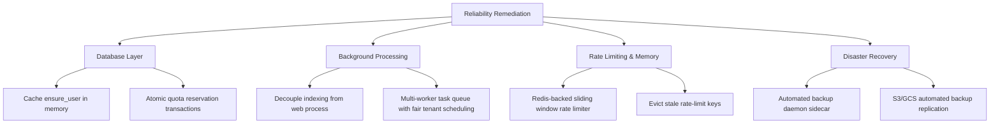

# AfriSearch AI — SaaS Reliability & Operational Readiness Report (PR-01)

**Audit Target:** AfriSearch AI Commercial SaaS Platform  
**Scope:** Database Concurrency, File Storage, Background Processing, Rate Limiting, Backups, and Production Deployment Infrastructure  
**Status:** Comprehensive Operational Audit  
**Date:** November 9, 2026  

---

## 1. Database Reliability & Concurrency

### 1.1. SQLite WAL Mode Characteristics and Concurrency Limits
- **Classification:** **Informational Observation & Architectural Constraint**
- **File & Line Reference:** [`backend/db.py:447-463`](file:///home/fewzan/Downloads/AfriSearch_AI_App_Starter/backend/db.py#L447-L463)
- **Current Behavior:**
  AfriSearch initializes SQLite with WAL mode (`PRAGMA journal_mode = WAL`) and sets a connection busy timeout of 30 seconds (`sqlite3.connect(path, timeout=30)`).
  - WAL mode permits concurrent readers without blocking readers or writers.
  - However, SQLite allows **strictly one writer at any given time**. Any write transaction locks the database until committed or rolled back.
- **Reliability Assessment:**
  While SQLite in WAL mode can support thousands of read requests per second, the current implementation routes frequent write operations through hot paths:
  1. `ensure_user()` writes on every authenticated request (`auth.py:78`).
  2. `check_can_upload()` iterates over all workspaces on disk on every upload attempt (`db.py:887-895`).
  3. Job progress writes (`jobs.py:65`) update the database every 500ms during indexing.
  When multiple tenants concurrently upload, index, or browse, requests will hit the 30-second lock timeout, surfacing HTTP 500 errors to end users.
- **Production Recommendation:**
  Migrate user sessions and read-cache layers into memory, and plan a transition path to PostgreSQL for commercial multi-tenant enterprise scale.

---

### 1.2. Non-Atomic Quota Checks & Concurrency Race Conditions
- **Classification:** **Verified Defect**
- **File & Line Reference:** [`backend/entitlements.py:91-155`](file:///home/fewzan/Downloads/AfriSearch_AI_App_Starter/backend/entitlements.py#L91-L155), [`backend/main.py:825-845`](file:///home/fewzan/Downloads/AfriSearch_AI_App_Starter/backend/main.py#L825-L845)
- **Failure Mode:**
  Before uploading files, `POST /documents/upload` calls `check_can_upload(org_id, total_bytes, len(files))`.
  1. `check_can_upload` queries SQLite and disk usage via `db.get_organization_usage_summary(org_id)`.
  2. The check succeeds if `summary["storage_bytes"] + new_bytes <= plan["max_storage_bytes"]`.
  3. The request handler then saves files to disk and triggers an asynchronous indexing job.
  4. Under concurrent execution (e.g. 10 simultaneous upload requests from the same organization), all 10 requests read the identical initial usage summary simultaneously and pass validation, exceeding the storage quota by up to 10x before usage counters reflect the increase.
- **Production Recommendation:**
  Wrap quota validation and quota pre-allocation within an atomic database transaction or an atomic Redis counter reservation.

---

## 2. Backup & Disaster Recovery

### 2.1. Online Backup Mechanism & Live Disk Race Conditions
- **Classification:** **Potential Risk requiring further testing**
- **File & Line Reference:** [`backend/backup.py:32-52`](file:///home/fewzan/Downloads/AfriSearch_AI_App_Starter/backend/backup.py#L32-L52)
- **Current Behavior:**
  [`backend/backup.py`](file:///home/fewzan/Downloads/AfriSearch_AI_App_Starter/backend/backup.py) utilizes the SQLite Online Backup API (`source.backup(target)`), ensuring that the SQLite database snapshot is consistent even during live writes.
  However, after snapshotting the database, the script archives the directory `data/workspaces` via `tarfile.open()`:
  ```python
  if (data_dir / "workspaces").is_dir():
      tar.add(data_dir / "workspaces", arcname="workspaces")
  ```
- **Failure Mode:**
  If a document is being uploaded or an embedding index (`embeddings.npy`, `index.json`) is being rebuilt while `tar.add` executes:
  - Files can be read in a partially written state.
  - If a file is deleted or renamed by a background process while being archived, `tarfile` raises `FileNotFoundError` or `FileChangedError`, terminating the backup process.
- **Production Recommendation:**
  Use filesystem snapshots (LVM/ZFS/EBS) or execute index writes to atomic temporary directories with rename swaps to prevent tar read tearing.

---

### 2.2. Missing Automated Backup Daemon in Production Deployment
- **Classification:** **Missing Capability**
- **File & Line Reference:** [`deploy/docker-compose.prod.yml:18-20`](file:///home/fewzan/Downloads/AfriSearch_AI_App_Starter/deploy/docker-compose.prod.yml#L18-L20)
- **Current State:**
  The production Docker Compose file mounts `./backups:/app/backups`, with a comment stating `python -m backend.backup create writes here`.
  However, there is **no cron service, background timer, or sidecar container** configured to trigger backups automatically. Unless a server administrator manually configures a host-level crontab, no automated backups will ever be executed.
- **Production Recommendation:**
  Add a dedicated lightweight backup sidecar container (or integrate a periodic schedule using `APScheduler` inside the application container) to trigger daily rolling backups to S3/GCS object storage.

---

## 3. Background Processing & Job Recovery

### 3.1. Single-Worker Thread Pool Indexing Bottleneck (Head-of-Line Blocking)
- **Classification:** **Verified Defect**
- **File & Line Reference:** [`backend/jobs.py:14-25`](file:///home/fewzan/Downloads/AfriSearch_AI_App_Starter/backend/jobs.py#L14-L25)
- **Vulnerability / Bottleneck:**
  `jobs.py` initializes:
  ```python
  _executor = ThreadPoolExecutor(max_workers=1, thread_name_prefix="indexer")
  ```
  All workspaces and organizations share this single worker thread. Indexing involves computationally expensive operations:
  - PDF text extraction and layout parsing.
  - OCR page rasterization via Tesseract (`eng+amh+swa`).
  - Sentence chunking and cross-chunk Markdown table header reconstruction.
  - Neural text embedding generation with `multilingual-e5-small`.
  A single tenant uploading a large PDF (e.g. 50 scanned pages) occupies the worker for 5-10 minutes. During this period, all other tenants' indexing jobs are queued and stalled, resulting in complete platform-wide ingestion starvation.
- **Production Recommendation:**
  Decouple indexing from the web process. Use an external task queue (such as Celery, RQ, or Redis Streams) with multiple worker processes, per-tenant fair queuing, and tenant concurrency caps.

---

### 3.2. Background Job Recovery on Crash
- **Classification:** **Informational Observation (Verified Functional)**
- **File & Line Reference:** [`backend/main.py:58-62`](file:///home/fewzan/Downloads/AfriSearch_AI_App_Starter/backend/main.py#L58-L62), [`backend/db.py:1437-1442`](file:///home/fewzan/Downloads/AfriSearch_AI_App_Starter/backend/db.py#L1437-L1442)
- **Observation:**
  AfriSearch implements `db.fail_interrupted_jobs()` during application lifespan startup:
  ```python
  conn.execute("UPDATE jobs SET status = 'failed', error = 'The server restarted. Run indexing again.', "
               "updated_at = ? WHERE status IN ('queued', 'running')", (now(),))
  ```
  This ensures that when a server terminates or restarts, dangling jobs are properly marked as failed rather than remaining permanently in "running" status.

---

## 4. Rate Limiting Across Workers

### 4.1. Process-Local In-Memory Rate Limiting
- **Classification:** **Verified Defect**
- **File & Line Reference:** [`backend/limits.py:30-55`](file:///home/fewzan/Downloads/AfriSearch_AI_App_Starter/backend/limits.py#L30-L55)
- **Current Behavior:**
  Rate limits (`AFRISEARCH_ASK_PER_MINUTE`, `AFRISEARCH_ASK_PER_DAY`, `AFRISEARCH_UPLOADS_PER_HOUR`) are tracked using an in-memory dictionary:
  ```python
  _events: dict[str, deque[float]] = {}
  _lock = threading.Lock()
  ```
- **Operational Failure Modes:**
  1. **Multi-Worker Bypass:** If uvicorn is configured with multiple worker processes (e.g. `uvicorn --workers 4`), each process maintains its own independent `_events` dictionary. A client can distribute requests across workers to exceed configured rate limits by 4x.
  2. **Unbounded Memory Leak:** When a user key makes a request, an entry is added to `_events`. While old timestamps are pruned from the `deque` on subsequent checks for that key, inactive user keys are never evicted from the `_events` dictionary, causing monotonic memory growth over long server runtimes.
- **Production Recommendation:**
  Replace in-memory rate limiting with a Redis-backed sliding window or token bucket limiter (e.g. using Redis `sorted sets` or standard rate-limiting middleware).

---

## 5. Deployment Configuration, Monitoring & Health Checks

### 5.1. Health Check Endpoint Readiness
- **Classification:** **Informational Observation (Verified Functional)**
- **File & Line Reference:** [`backend/main.py:1385-1396`](file:///home/fewzan/Downloads/AfriSearch_AI_App_Starter/backend/main.py#L1385-L1396), [`Dockerfile:40-41`](file:///home/fewzan/Downloads/AfriSearch_AI_App_Starter/Dockerfile#L40-L41)
- **Observation:**
  The API exposes `GET /api/health`, returning:
  ```json
  {"status": "ok", "version": "0.2.0", "auth": "none", "documents": 12, "chunks": 48}
  ```
  The Dockerfile includes an automated healthcheck probe:
  ```dockerfile
  HEALTHCHECK --interval=15s --timeout=5s --start-period=120s --retries=5 \
      CMD python -c "import urllib.request; urllib.request.urlopen('http://127.0.0.1:8000/api/health')"
  ```
  This is well-configured for container orchestration (Docker Compose / Kubernetes) restarts.

---

### 5.2. Missing Billing Environment Variables in Production Compose
- **Classification:** **Verified Defect**
- **File & Line Reference:** [`deploy/docker-compose.prod.yml:8-17`](file:///home/fewzan/Downloads/AfriSearch_AI_App_Starter/deploy/docker-compose.prod.yml#L8-L17)
- **Failure Mode:**
  Production deployments launched via `deploy/docker-compose.prod.yml` do not map Stripe and Chapa environment variables into the container. Unless manually edited, payment processing and webhook verifications will fail in production.
- **Production Recommendation:**
  Update `deploy/docker-compose.prod.yml` to explicitly forward `STRIPE_SECRET_KEY`, `STRIPE_WEBHOOK_SECRET`, `CHAPA_SECRET_KEY`, `CHAPA_WEBHOOK_SECRET`, and `BILLING_RETURN_URL_BASE`.

---

## 6. Reliability Remediation Roadmap


